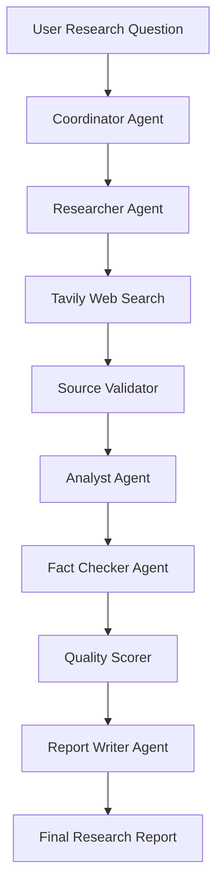

# AI Multi-Agent Research & Automation System

An intelligent, web-based research and automation platform powered by specialized AI agents. The system coordinates research planning, web search, source validation, information analysis, fact-checking, quality evaluation, and automated report generation.

Built with **Python, FastAPI, LangGraph, Groq, Tavily, React, and SQLite**.

[](https://ai-multi-agent-system.rayankhan9465.workers.dev)
[](https://ai-multi-agent-backend.hostless.app)
[](https://www.python.org/)
[](https://react.dev/)

## Live Application

- **Frontend:** https://ai-multi-agent-system.rayankhan9465.workers.dev
- **Backend API:** https://ai-multi-agent-backend.hostless.app
- **API Documentation:** https://ai-multi-agent-backend.hostless.app/docs
- **Backend Health:** https://ai-multi-agent-backend.hostless.app/health

The application provides a dashboard for submitting research questions, tracking tasks, monitoring agents, viewing analytics, and accessing generated research reports.

*Note: Availability and response times depend on the free hosting provider.*

## Project Overview

Traditional research workflows often require manually searching multiple websites, reviewing sources, analyzing information, checking factual consistency, and preparing reports.

This project automates much of that process through a coordinated multi-agent architecture.

Each specialized agent performs a particular responsibility. LangGraph orchestrates the workflow, while FastAPI exposes the backend functionality to an interactive React dashboard.

## Key Features

- **Multi-Agent Architecture:** Specialized AI agents collaborate through a coordinated workflow.
- **Research Planning:** Organizes research questions into structured execution plans.
- **Web Search:** Retrieves relevant information using Tavily.
- **Source Validation:** Checks collected sources for quality and validity.
- **AI Analysis:** Analyzes collected research information.
- **Fact Checking:** Reviews findings for factual consistency.
- **Quality Scoring:** Evaluates research output quality.
- **Automated Report Generation:** Produces structured research reports.
- **Task Management:** Creates, updates, and tracks research tasks.
- **Task Scheduling:** Supports scheduled task execution.
- **Priority Management:** Organizes tasks according to priority.
- **Task Dependencies:** Supports dependency-aware task management.
- **Research History:** Maintains records of previous research activities.
- **Agent Monitoring:** Tracks agent execution and workflow activity.
- **Retry Management:** Supports handling failed operations.
- **Audit History:** Maintains workflow activity records.
- **Analytics Dashboard:** Displays research and agent-related statistics.
- **REST API:** Exposes backend capabilities through FastAPI.
- **Interactive Frontend:** Provides a React-based dashboard.

## Multi-Agent Architecture

The system uses LangGraph to coordinate specialized agents.

### Research Workflow

1. **Coordinator Agent:** Organizes the research task and prepares the workflow.
2. **Researcher Agent:** Retrieves relevant information using Tavily.
3. **Source Validator:** Checks collected sources.
4. **Analyst Agent:** Examines and analyzes research information.
5. **Fact Checker Agent:** Reviews research findings for factual consistency.
6. **Quality Scorer:** Evaluates the quality of the research output.
7. **Report Writer Agent:** Generates the final research report.

### Workflow Diagram



The workflow uses shared research state to coordinate information between its stages.

## Technology Stack

### Backend

| Technology | Purpose |
|---|---|
| Python | Core programming language |
| FastAPI | Backend API framework |
| LangGraph | Multi-agent workflow orchestration |
| LangChain Core | LLM integration components |
| Groq | Large language model integration |
| Tavily | Web search and information retrieval |
| Pydantic | Data validation |
| SQLite | Task and research data storage |
| PostgreSQL Driver | PostgreSQL connectivity |
| Uvicorn | ASGI application server |
| Pytest | Testing framework |

### Frontend

| Technology | Purpose |
|---|---|
| React 19 | User interface |
| Vite | Frontend development and build tool |
| Tailwind CSS | Styling |
| Lucide React | Interface icons |
| Recharts | Data visualization |
| React Markdown | Markdown rendering |
| Remark GFM | GitHub-flavored Markdown support |

## Project Structure

```text
AI_Multi_Agent_System/
│
├── backend/
│   ├── agents/
│   │   ├── fact_checker.py
│   │   ├── quality_scorer.py
│   │   ├── report_writer.py
│   │   └── researcher.py
│   │
│   ├── graph/
│   │   ├── state.py
│   │   └── workflow.py
│   │
│   ├── schemas/
│   │
│   ├── services/
│   │   ├── agent_analytics.py
│   │   ├── agent_monitor.py
│   │   ├── database.py
│   │   ├── monitored_agent.py
│   │   ├── report_retrieval.py
│   │   ├── report_service.py
│   │   ├── research_history.py
│   │   ├── retry_manager.py
│   │   ├── source_validator.py
│   │   ├── system_monitor.py
│   │   ├── task_claiming.py
│   │   ├── task_database.py
│   │   ├── task_dependencies.py
│   │   ├── task_manager.py
│   │   ├── task_priority.py
│   │   ├── task_scheduler.py
│   │   └── workflow_tracer.py
│   │
│   ├── tools/
│   ├── main.py
│   ├── functional_test_tasks.py
│   ├── functional_test_workflow.py
│   ├── smoke_test_api.py
│   └── test_*.py
│
├── frontend/
│   ├── public/
│   ├── src/
│   │   ├── assets/
│   │   ├── App.jsx
│   │   ├── App.css
│   │   ├── index.css
│   │   └── integration.css
│   ├── .env.example
│   ├── package.json
│   └── vite.config.js
│
├── docs/
│   ├── ARCHITECTURE.md
│   └── mermaid-diagram.png
│
├── reports/
├── screenshots/
├── tests/
├── requirements.txt
├── backend_openapi.json
├── backend_samples.json
├── .gitignore
└── README.md
```

## Application Screenshots

### 1. Main Dashboard

Overview of the research platform and its main components.


### 2. New Research

Submit research questions and initiate automated research workflows.


### 3. AI Agents

Explore the specialized agents responsible for research operations.


### 4. Task Manager

Monitor and manage research tasks and execution status.


### 5. Analytics Dashboard

Visualize research activity and agent performance.


### 6. Research Report

View the structured report generated by the multi-agent workflow.


## Installation and Setup

### Prerequisites

- Python 3.11 or compatible version
- Node.js and npm
- Git
- Groq API key
- Tavily API key

### 1. Clone the Repository

```powershell
git clone https://github.com/rayankhan-ai/AI_Multi_Agent_System.git
cd AI_Multi_Agent_System
```

### 2. Create a Python Virtual Environment

```powershell
python -m venv .venv
```

Activate it:

```powershell
.\.venv\Scripts\Activate.ps1
```

Install backend dependencies:

```powershell
pip install -r requirements.txt
```

### 3. Configure Environment Variables

Create a `.env` file in the project root:

```env
GROQ_API_KEY=your_groq_api_key
TAVILY_API_KEY=your_tavily_api_key
```

Obtain API credentials from:

- Groq: https://console.groq.com/
- Tavily: https://tavily.com/

Never upload actual API credentials to GitHub.

### 4. Configure the Frontend

Move into the frontend directory:

```powershell
cd frontend
```

Install frontend dependencies:

```powershell
npm install
```

Create a `.env` file:

```env
VITE_API_URL=http://127.0.0.1:8000
```

Return to the project root:

```powershell
cd ..
```

## Running the Application Locally

Run the backend and frontend in separate terminals.

### Start the Backend

From the project root:

```powershell
.\.venv\Scripts\Activate.ps1
python -m uvicorn backend.main:app --reload
```

Backend:

http://127.0.0.1:8000

API documentation:

http://127.0.0.1:8000/docs

### Start the Frontend

Open another terminal:

```powershell
cd frontend
npm run dev
```

Frontend:

http://localhost:5173

The frontend communicates with the backend through `VITE_API_URL`.

## API Documentation

The backend provides interactive API documentation through FastAPI Swagger UI.

Local:

http://127.0.0.1:8000/docs

Production:

https://ai-multi-agent-backend.hostless.app/docs

The API supports research execution, task management, scheduling, reports, research history, workflow monitoring, analytics, and health checks.

## Testing

The repository includes testing scripts for important backend components.

Examples include:

- Research workflow testing
- Source validation
- Quality scoring
- Report services
- Research history
- Retry management
- Task management
- API smoke testing
- Groq connectivity
- Tavily connectivity

Run individual tests from the project root according to their module imports and environment requirements.

Example:

```powershell
python -m pytest backend/test_quality_scorer.py -v
```

Build the frontend:

```powershell
cd frontend
npm run build
```

## Security Considerations

- API credentials are stored in environment variables.
- `.env` files are excluded from version control.
- Generated databases and reports are excluded from the public repository.
- API keys must never be committed to GitHub.
- Production credentials should be configured through the hosting provider's environment settings.

## Future Improvements

Potential enhancements include:

- User authentication and role-based access.
- Human-in-the-loop research approval.
- Additional specialized AI agents.
- Advanced research evaluation and benchmarking.
- More comprehensive automated testing.
- Additional report export formats.
- Improved scheduling and distributed task execution.

## Learning Outcomes

This project demonstrates practical implementation of:

- Agentic AI concepts
- Multi-agent collaboration
- LangGraph workflow orchestration
- LLM integration with Groq
- Web research using Tavily
- Source validation and fact-checking
- AI-powered research report generation
- FastAPI backend development
- React frontend integration
- Database-backed task management
- Task scheduling and prioritization
- Monitoring, analytics, and error handling
- Full-stack AI application deployment

## Author

**Rayan Ahmad**

GitHub: https://github.com/rayankhan-ai

Repository: https://github.com/rayankhan-ai/AI_Multi_Agent_System

If you find this project useful, consider giving the repository a star!