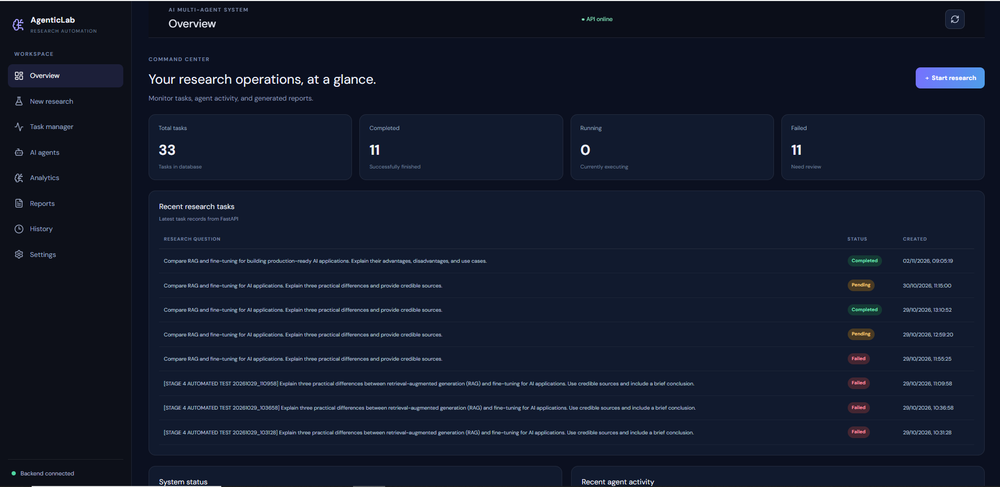
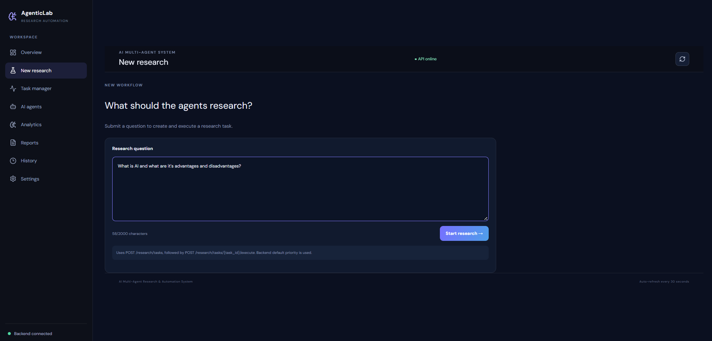
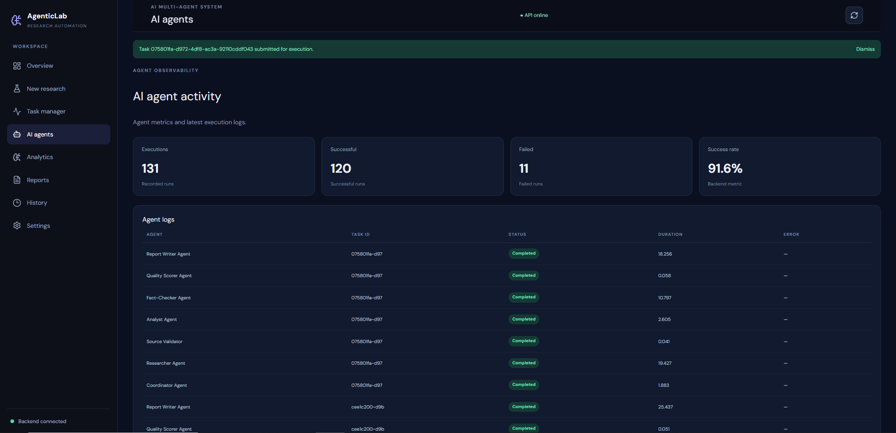
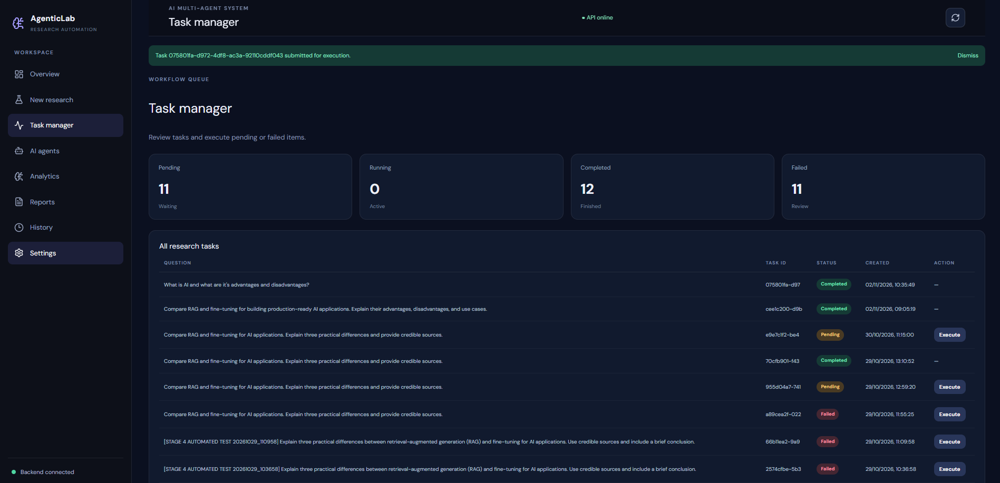
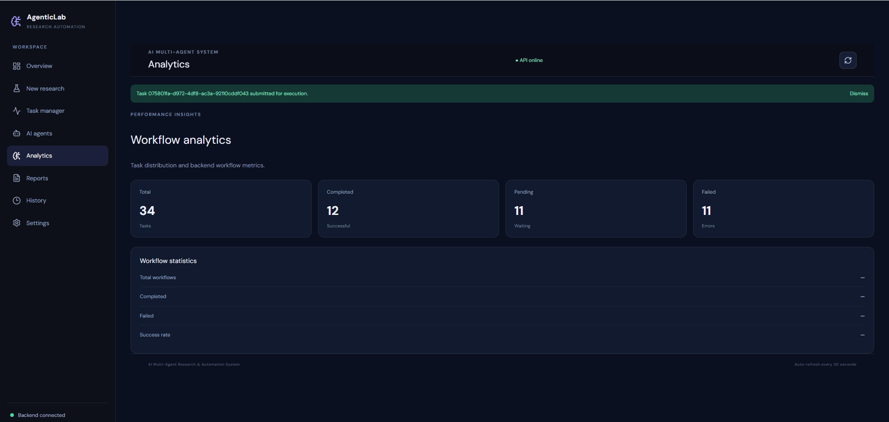
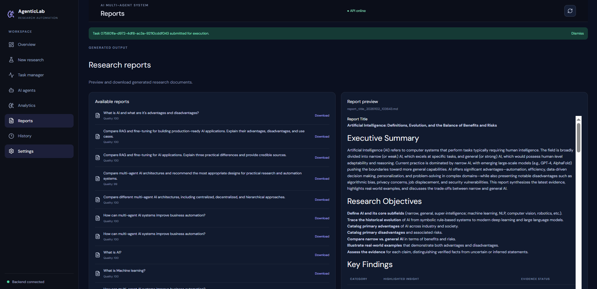

# AI Multi-Agent Research & Automation System

An intelligent research and automation platform powered by multiple AI agents. The system coordinates research, validates sources, analyzes information, fact-checks findings, evaluates research quality, and generates structured research reports.

Built with **FastAPI, LangGraph, Groq, Tavily, React, and SQLite**.

---

## Project Overview

The AI Multi-Agent Research & Automation System is designed to automate complex research tasks through a coordinated workflow of specialized AI agents.

Instead of relying on a single AI model to perform every task, the system divides research into smaller stages. Each agent performs a specific responsibility, and the workflow coordinates their execution to produce a structured research report.

The platform provides a web-based dashboard for submitting research questions, monitoring tasks, viewing reports, and analyzing system activity.

## Key Features

* **Multi-Agent Architecture:** Specialized agents collaborate to complete research tasks.
* **AI Research Planning:** Organizes research questions into a structured workflow.
* **Web Search Integration:** Retrieves relevant information using Tavily.
* **Source Validation:** Checks research sources for quality and validity.
* **AI Analysis:** Analyzes collected research information.
* **Fact Checking:** Reviews findings for factual consistency.
* **Research Quality Scoring:** Evaluates the quality of research results.
* **Automated Report Generation:** Produces structured research reports.
* **Task Management:** Stores and manages research tasks using SQLite.
* **Research History:** Maintains records of previous research activities.
* **Agent Monitoring:** Tracks agent execution and workflow activity.
* **Retry Management:** Supports handling failed operations.
* **Analytics Dashboard:** Displays research and agent-related information.
* **REST API:** Provides backend functionality through FastAPI.
* **React Dashboard:** Offers an interactive frontend for using the system.

## Multi-Agent Architecture

The system uses a coordinated workflow built with LangGraph.

### Main Workflow

1. **Coordinator:** Organizes the research task and prepares the workflow.
2. **Researcher:** Searches for relevant information using Tavily.
3. **Source Validator:** Validates collected research sources.
4. **Analyst:** Examines and analyzes the collected information.
5. **Fact Checker:** Reviews research findings for factual consistency.
6. **Quality Scorer:** Evaluates the quality of the research.
7. **Report Writer:** Generates the final research report.

### Workflow Overview

```text
          User Research Question
                    |
                    v
              Coordinator
                    |
                    v
               Researcher
                    |
                    v
             Source Validator
                    |
                    v
                 Analyst
                    |
                    v
              Fact Checker
                    |
                    v
              Quality Scorer
                    |
                    v
              Report Writer
                    |
                    v
             Final Research Report
```

The workflow is implemented using LangGraph and shared research state.

## Technology Stack

### Backend

| Technology     | Purpose                              |
| -------------- | ------------------------------------ |
| Python         | Core programming language            |
| FastAPI        | Backend API framework                |
| LangGraph      | Multi-agent workflow orchestration   |
| LangChain Core | LLM integration components           |
| ChatGroq       | Large language model integration     |
| Tavily         | Web search and information retrieval |
| Pydantic       | Data validation                      |
| SQLite         | Task and research data storage       |
| Uvicorn        | ASGI application server              |
| Pytest         | Testing framework                    |

### Frontend

| Technology     | Purpose                             |
| -------------- | ----------------------------------- |
| React 19       | User interface                      |
| Vite           | Frontend development and build tool |
| Tailwind CSS   | Styling                             |
| Lucide React   | Interface icons                     |
| Recharts       | Data visualization                  |
| React Markdown | Markdown rendering                  |
| Remark GFM     | GitHub-flavored Markdown support    |

## Project Structure

```text
AI_Multi_Agent_System/
│
├── backend/
│   ├── agents/
│   │   ├── fact_checker.py
│   │   ├── quality_scorer.py
│   │   ├── report_writer.py
│   │   └── researcher.py
│   │
│   ├── graph/
│   │   ├── state.py
│   │   └── workflow.py
│   │
│   ├── schemas/
│   │
│   ├── services/
│   │   ├── agent_analytics.py
│   │   ├── agent_monitor.py
│   │   ├── monitored_agent.py
│   │   ├── report_retrieval.py
│   │   ├── report_service.py
│   │   ├── research_history.py
│   │   ├── retry_manager.py
│   │   ├── source_validator.py
│   │   ├── system_monitor.py
│   │   ├── task_claiming.py
│   │   ├── task_database.py
│   │   ├── task_dependencies.py
│   │   ├── task_manager.py
│   │   ├── task_priority.py
│   │   ├── task_scheduler.py
│   │   └── workflow_tracer.py
│   │
│   ├── tools/
│   ├── main.py
│   └── test_*.py
│
├── frontend/
│   ├── public/
│   ├── src/
│   │   ├── App.jsx
│   │   ├── App.css
│   │   ├── index.css
│   │   └── integration.css
│   ├── .env.example
│   ├── package.json
│   └── vite.config.js
│
├── reports/
├── screenshots/
├── requirements.txt
├── backend_openapi.json
├── backend_samples.json
└── README.md
```

## Installation and Setup

### 1. Clone the Repository

```bash
git clone https://github.com/rayankhan-ai/AI_Multi_Agent_System.git
```

Move into the project directory:

```bash
cd AI_Multi_Agent_System
```

### 2. Set Up the Python Environment

Create a virtual environment:

```bash
python -m venv .venv
```

Activate it on Windows PowerShell:

```powershell
.\.venv\Scripts\Activate.ps1
```

Install the backend dependencies:

```bash
pip install -r requirements.txt
```

### 3. Configure Environment Variables

Create a `.env` file in the project root.

Add your own API credentials:

```env
GROQ_API_KEY=your_groq_api_key
TAVILY_API_KEY=your_tavily_api_key
```

Never upload your actual API keys or `.env` file to GitHub.

API providers:

* Groq: https://console.groq.com/
* Tavily: https://tavily.com/

### 4. Configure the Frontend

Move into the frontend directory:

```powershell
cd frontend
```

Install dependencies:

```powershell
npm install
```

Create a frontend `.env` file:

```env
VITE_API_URL=http://127.0.0.1:8000
```

Return to the project root:

```powershell
cd ..
```

## Running the Application

You need to run the backend and frontend in separate terminals.

### Start the Backend

From the project root, activate the virtual environment and execute:

```powershell
python -m uvicorn backend.main:app --reload
```

Backend:

```text
http://127.0.0.1:8000
```

Interactive API documentation:

```text
http://127.0.0.1:8000/docs
```

### Start the Frontend

Open another PowerShell terminal:

```powershell
cd AI_Multi_Agent_System\frontend
```

Start the development server:

```powershell
npm run dev
```

Frontend:

```text
http://localhost:5173
```

The frontend communicates with the backend through the configured `VITE_API_URL`.

## Application Screenshots

### 1. Dashboard

The main dashboard provides an overview of the AI Multi-Agent Research and Automation System.



### 2. New Research

Submit research questions and initiate automated research workflows.



### 3. AI Agents

Explore the specialized AI agents responsible for different research operations.



### 4. Task Manager

Monitor and manage research tasks and their execution status.



### 5. Analytics Dashboard

Visualize research activity and agent performance through analytics.



### 6. Research Report

View the structured research report generated by the multi-agent workflow.




## API Documentation

FastAPI provides interactive API documentation through Swagger UI.

After starting the backend, visit:

```text
http://127.0.0.1:8000/docs
```

The API provides functionality for research execution, task management, research history, reports, analytics, agent monitoring, and system health.

## Testing

The backend includes test and functional test scripts for important components, including:

* Research workflow
* Source validation
* Quality scoring
* Report services
* Research history
* Retry management
* Task management
* API smoke testing
* Groq and Tavily connectivity

Run the relevant test scripts from the project root or backend directory according to their imports and execution requirements.

## Security

* API credentials are stored in local environment files.
* Environment files are excluded from version control.
* Generated databases and research reports are kept out of the public repository.
* API keys should never be committed to GitHub.

## Future Improvements

Potential future enhancements include:

* Deployment to cloud hosting.
* User authentication and role-based access.
* More specialized research agents.
* Advanced human-in-the-loop approval.
* Improved research evaluation and benchmarking.
* More advanced task scheduling and automation.
* Exporting reports into additional formats.
* Expanded automated testing.

## Learning Outcomes

This project demonstrates practical implementation of:

* Agentic AI concepts
* Multi-agent collaboration
* LangGraph workflow orchestration
* LLM integration with Groq
* Retrieval of web information with Tavily
* Source validation and fact-checking
* AI-generated research reports
* FastAPI backend development
* React frontend integration
* SQLite-based task management
* Monitoring, analytics, and error handling

## Author

**Rayan Ahmad**

Aspiring Agentic AI Engineer

GitHub: https://github.com/rayankhan-ai


If you find this project useful, consider giving the repository a star!
