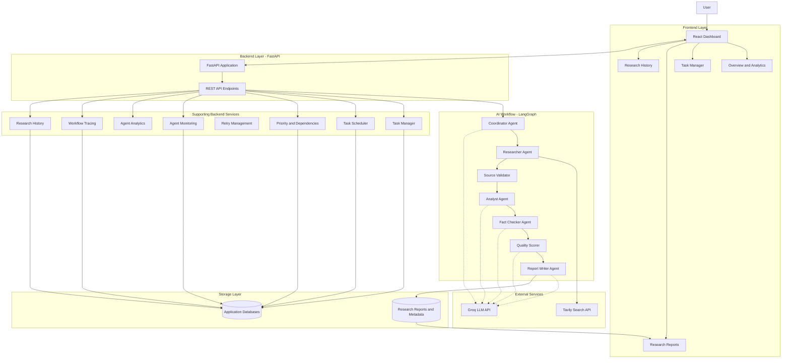

# AI Multi-Agent Research & Automation System — Architecture

## 1. Overview

The AI Multi-Agent Research & Automation System uses a frontend-backend architecture with a coordinated AI research workflow.

The React frontend communicates with a FastAPI backend. The backend executes specialized AI agents using LangGraph, integrates Groq for language-model capabilities, and uses Tavily for web research.

Supporting backend services provide task management, scheduling, source validation, monitoring, retries, analytics, research history, and workflow tracing.

## 2. High-Level System Architecture

*The diagram is a high-level conceptual representation of the system. Exact service interactions and storage configuration depend on their respective implementations.*

## 3. Core Research Workflow

The LangGraph workflow is implemented in:

`backend/graph/workflow.py`

It uses the shared state defined in:

`backend/graph/state.py`

### Workflow Execution Sequence

1. **Coordinator Agent**
   - Receives the research question.
   - Uses Groq to generate a structured research plan.
   - Breaks the question into specific research tasks.

2. **Researcher Agent**
   - Searches for relevant information using Tavily.
   - Collects research sources and supporting content.

3. **Source Validator**
   - Validates collected sources.
   - Removes invalid and duplicate sources.
   - Records accepted and rejected source counts.

4. **Analyst Agent**
   - Examines validated research evidence.
   - Addresses the original question and research plan.
   - Produces an evidence-based analysis.

5. **Fact Checker Agent**
   - Reviews research findings.
   - Evaluates factual consistency.

6. **Quality Scorer**
   - Evaluates the research output.
   - Produces quality scores and feedback.

7. **Report Writer Agent**
   - Generates the final research report.
   - Saves the Markdown report.
   - Saves corresponding research metadata.

### Conditional Workflow Routing

The workflow uses conditional routing after:

- Coordinator execution.
- Researcher execution.
- Source validation.

If a required stage fails or no usable research sources remain, the workflow stops instead of continuing with invalid input.

## 4. Shared Research State

The workflow uses a shared `ResearchState` TypedDict.

Important state fields include:

| Field | Purpose |
|---|---|
| `task_id` | Identifies the associated research task |
| `research_question` | Original research question |
| `research_plan` | Tasks generated by the Coordinator |
| `search_results` | Validated research sources |
| `analysis` | Analyst's findings |
| `fact_check` | Fact-checking information |
| `final_report` | Final generated report |
| `status` | Current workflow status |
| `error` | Error information |
| `activity_log` | Workflow activity messages |
| `total_sources` | Total collected sources |
| `accepted_sources` | Validated sources |
| `rejected_sources` | Rejected sources |
| `quality_score` | Research quality score |
| `quality_feedback` | Quality evaluation feedback |
| `research_id` | Unique research identifier |
| `research_timestamp` | Research execution timestamp |
| `report_filename` | Generated report filename |
| `metadata_filename` | Generated metadata filename |
| `agent_log_ids` | Agent monitoring identifiers |

## 5. Supporting Backend Services

The core workflow is supported by additional backend services.

| Service | Responsibility |
|---|---|
| Task Manager | Creates and manages research tasks |
| Task Scheduler | Handles scheduled task execution |
| Task Priority | Manages task priorities |
| Task Dependencies | Tracks task dependencies |
| Agent Monitor | Records agent execution |
| Retry Manager | Handles eligible temporary failures |
| Agent Analytics | Provides agent-related statistics |
| Workflow Tracer | Records workflow execution events |
| Research History | Maintains research records |
| Source Validator | Validates and deduplicates sources |
| Report Service | Saves generated reports |
| System Monitor | Provides system monitoring information |

## 6. Technology Architecture

### Backend
- Python
- FastAPI
- LangGraph
- LangChain Core
- Groq
- Tavily
- Pydantic
- SQLite
- PostgreSQL connectivity
- Uvicorn

### Frontend
- React
- Vite
- Tailwind CSS
- Lucide React
- Recharts
- React Markdown
- Remark GFM

### External Services
- Groq API for language-model inference.
- Tavily API for web search.

## 7. Data Flow

1. The user submits a research question through the React dashboard.
2. The frontend sends the request to the FastAPI backend.
3. The backend initiates the research workflow.
4. The Coordinator creates a research plan.
5. The Researcher collects information using Tavily.
6. The Source Validator checks the collected sources.
7. The Analyst processes the validated evidence.
8. The Fact Checker reviews the findings.
9. The Quality Scorer evaluates the research output.
10. The Report Writer generates and saves the final report.
11. The backend records relevant task and research information.
12. The frontend displays the research results.

## 8. Monitoring and Reliability

The system includes supporting mechanisms for observing and managing execution:

- Agent execution monitoring.
- Workflow execution tracing.
- Bounded retry handling for eligible temporary failures.
- Task scheduling and prioritization.
- Task dependency management.
- Research history.
- Audit history.
- Workflow and agent analytics.
- Error reporting and health checks.

These components help monitor the application and manage research execution.

## 9. Deployment Architecture

The project is deployed using separate frontend and backend hosting.

| Component | Deployment |
|---|---|
| Frontend | Cloudflare Workers |
| Backend | Hostless |
| Backend API | FastAPI |
| Language Model | Groq |
| Web Search | Tavily |

### Production Links

- Frontend: https://ai-multi-agent-system.rayankhan9465.workers.dev
- Backend: https://ai-multi-agent-backend.hostless.app
- API Documentation: https://ai-multi-agent-backend.hostless.app/docs
- Health Check: https://ai-multi-agent-backend.hostless.app/health

## 10. Conclusion

This architecture demonstrates how specialized AI agents, workflow orchestration, external AI services, backend services, databases, and a modern frontend can work together to automate research tasks.

The system combines agent collaboration with task management, monitoring, source validation, quality evaluation, and structured report generation.