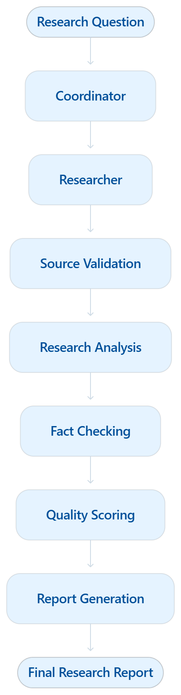

# System Architecture

## 1. Overview

The AI Multi-Agent Research & Automation System uses a
frontend-backend architecture with an AI-powered multi-agent
workflow.

The frontend communicates with the FastAPI backend.
The backend coordinates specialized AI agents using LangGraph.

## 2. High-Level System Architecture

```mermaid
flowchart TD

    U["User"]

    subgraph FRONTEND["Frontend Layer"]
        UI["React Dashboard"]
        DASH["Dashboard and Analytics"]
        TASK["Task Manager"]
        REPORT["Research Reports"]
    end

    subgraph BACKEND["Backend Layer - FastAPI"]
        API["FastAPI Application"]
        ROUTES["API Endpoints"]
    end

    subgraph AGENTS["Multi-Agent Workflow - LangGraph"]
        COORD["Coordinator Agent"]
        RES["Researcher Agent"]
        VALID["Source Validator"]
        ANALYST["Analyst Agent"]
        FACT["Fact Checker Agent"]
        QUALITY["Quality Scorer"]
        WRITER["Report Writer Agent"]
    end

    subgraph SERVICES["Backend Services"]
        MON["Agent Monitoring"]
        RETRY["Retry Manager"]
        HISTORY["Research History"]
        ANALYTICS["Agent Analytics"]
        TASKDB["Task Management"]
    end

    subgraph STORAGE["Storage Layer"]
        DB[("SQLite Database")]
        FILES[("Research Reports")]
    end

    subgraph EXTERNAL["External AI Services"]
        GROQ["Groq LLM"]
        TAVILY["Tavily Search API"]
    end

    U --> UI
    UI --> DASH
    UI --> TASK
    UI --> REPORT

    UI <--> API
    API --> ROUTES
    ROUTES --> COORD

    COORD --> RES
    RES --> TAVILY
    RES --> VALID
    VALID --> ANALYST
    ANALYST --> FACT
    FACT --> QUALITY
    QUALITY --> WRITER

    COORD -.-> GROQ
    ANALYST -.-> GROQ
    FACT -.-> GROQ
    WRITER -.-> GROQ

    ROUTES --> MON
    ROUTES --> RETRY
    ROUTES --> HISTORY
    ROUTES --> ANALYTICS
    ROUTES --> TASKDB

    TASKDB --> DB
    HISTORY --> DB
    WRITER --> FILES
    MON --> DB

## 3. Research Workflow

The research workflow consists of specialized agents.



## 4. Component Responsibilities

| Component        | Responsibility                       |
| ---------------- | ------------------------------------ |
| React Frontend   | User interaction and dashboard       |
| FastAPI          | Backend API and request handling     |
| LangGraph        | Workflow orchestration               |
| Coordinator      | Organizes research execution         |
| Researcher       | Retrieves information from the web   |
| Source Validator | Validates collected sources          |
| Analyst          | Analyzes research information        |
| Fact Checker     | Reviews research findings            |
| Quality Scorer   | Evaluates research quality           |
| Report Writer    | Generates final reports              |
| Groq             | Provides LLM capabilities            |
| Tavily           | Provides web search                  |
| SQLite           | Stores task and research information |

## 5. Data Flow

1. The user submits a research question through React.
2. React sends the request to FastAPI.
3. FastAPI initiates the LangGraph workflow.
4. The Coordinator organizes the research process.
5. The Researcher collects information using Tavily.
6. The Source Validator checks collected sources.
7. The Analyst processes the research information.
8. The Fact Checker reviews the findings.
9. The Quality Scorer evaluates research quality.
10. The Report Writer generates the final report.
11. The backend stores relevant task information.
12. The frontend displays the research results.

## 6. Technologies
Python
FastAPI
LangGraph
LangChain
Groq
Tavily
SQLite
React
Vite
Tailwind CSS
Recharts


**Important:** This is a high-level conceptual architecture. The exact connections and execution order should match the implementation in `backend/graph/workflow.py`; we'll verify them before treating the diagram as the final technical specification.

## Step 3 — Preview the architecture

Save the file.

Open your GitHub repository and navigate to:

`docs/ARCHITECTURE.md`

GitHub supports Mermaid diagrams, so it should render the diagrams visually.

You can also use the official :contentReference[oaicite:0]{index=0} to preview them.

## Step 4 — Commit the architecture documentation

Run:

```powershell
git add docs/ARCHITECTURE.md